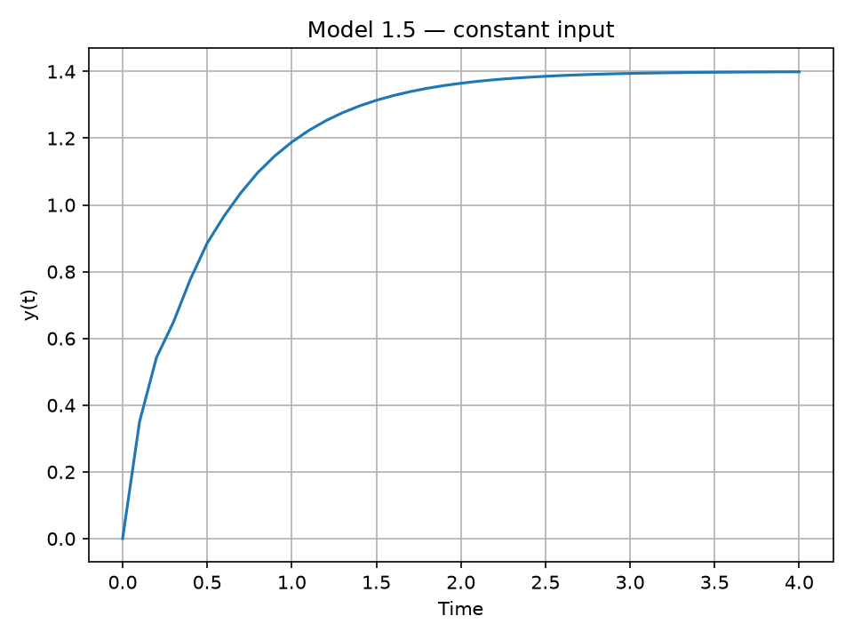
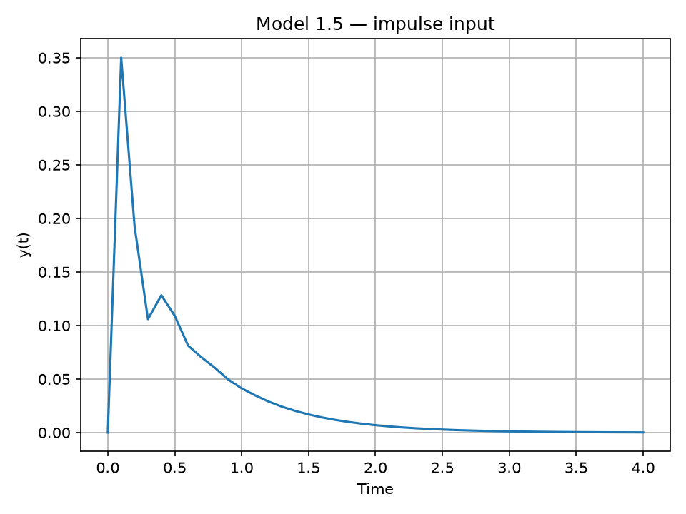
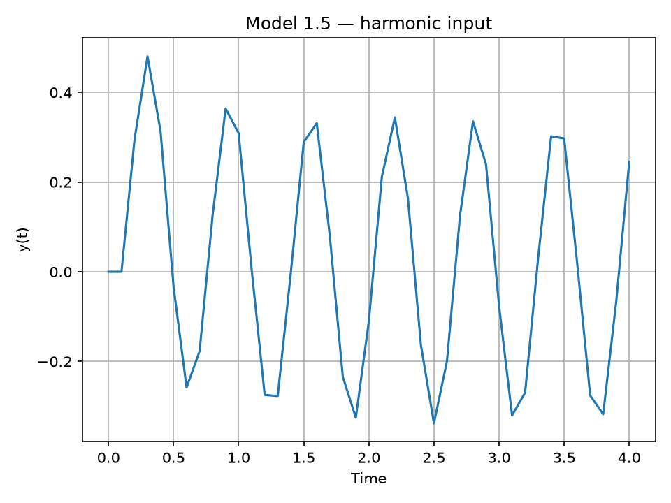
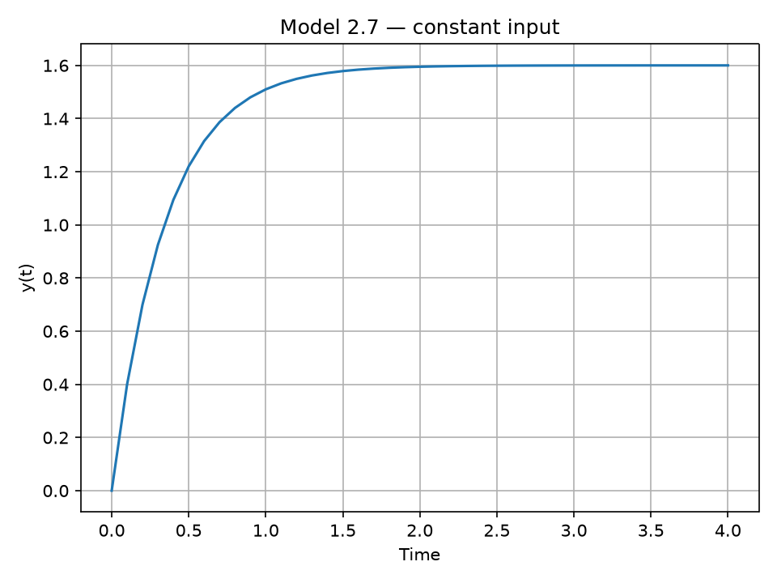
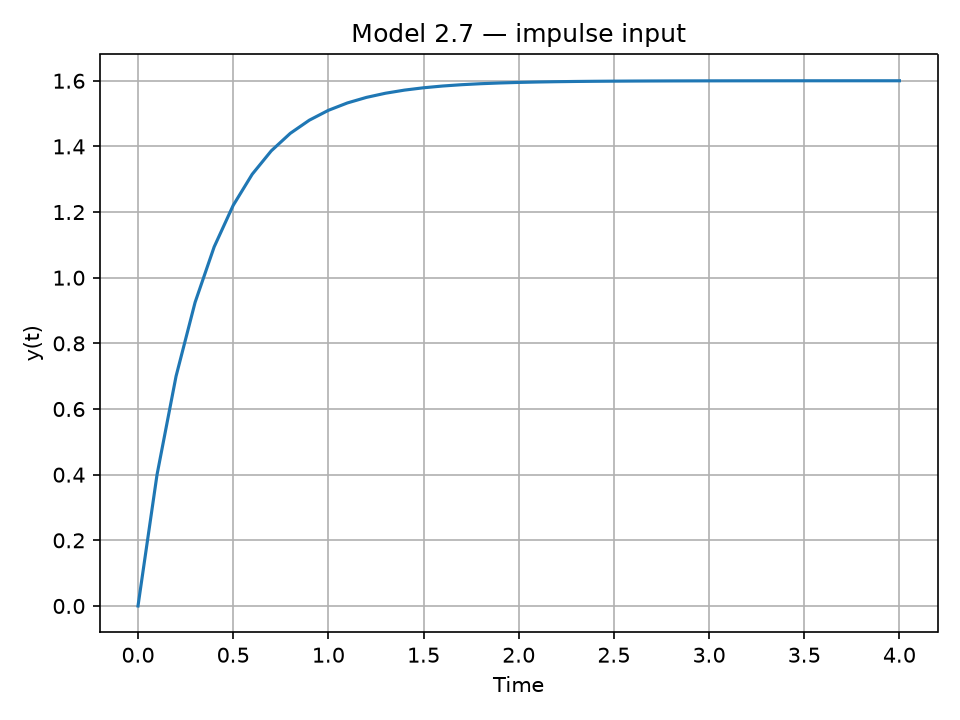
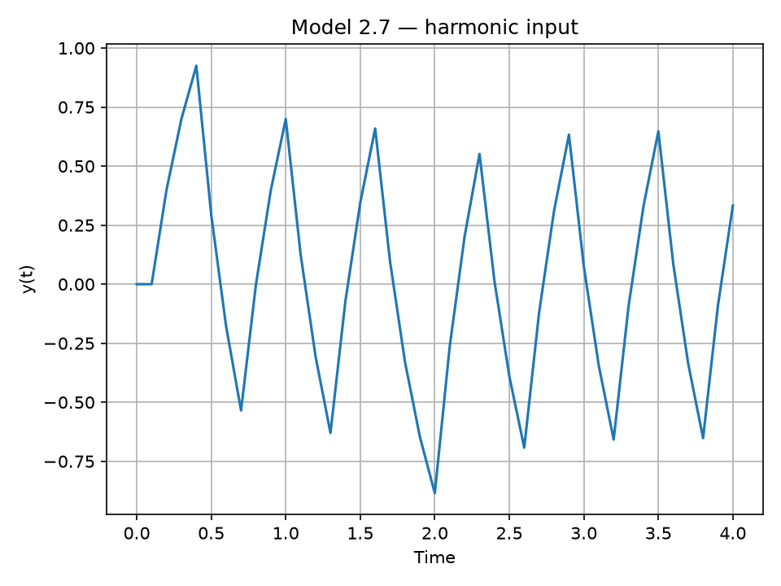
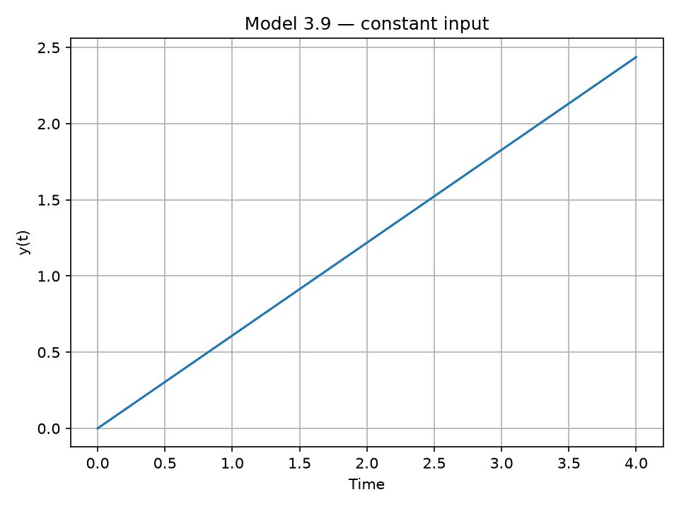
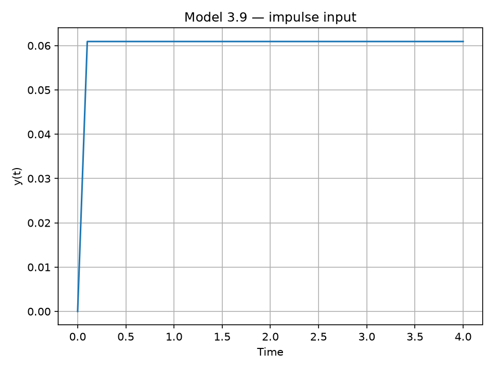
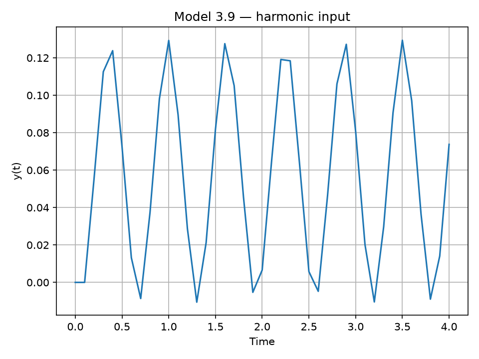

 <p align="center">Министерство образования Республики Беларусь</p>
<p align="center">Учреждение образования</p>
<p align="center">«Брестский государственный технический университет»</p>
<p align="center">Кафедра ИИТ</p>

<br><br><br>

<p align="center"><b>ЛАБОРАТОРНАЯ РАБОТА № 1</b></p>
<p align="center"><b>По дисциплине: «Общая теория интеллектуальных систем»</b></p>
<p align="center"><b>Тема: «Моделирование динамических систем»</b></p>

<br><br><br>

<p align="right">Выполнил:</p>
<p align="right">Студент 2 курса группы ИИ-29</p>
<p align="right">Евтеев М. Е.</p>
<p align="right">Проверил:</p>
<p align="right">Дворанинович Д. А.</p>

<br><br><br>

<p align="center">Брест 2026</p>

---

## 1. Цель работы

Реализовать математические модели динамических систем на языке C++ с использованием объектно-ориентированного подхода и исследовать их поведение при различных входных воздействиях.

## 2. Вариант задания

Вариант 5. Реализованы три математические модели:

- **Model 1.5** — линейная модель с задержкой;
- **Model 2.7** — модель с релейным элементом и гистерезисом;
- **Model 3.9** — модель с нелинейной функцией `tanh`.

## 3. Математические модели

### 3.1. Model 1.5

Модель описывается разностным уравнением:

$$
y[n+1] = a_1 y[n] + a_2 y[n-k] + b u[n]
$$

где `a1`, `a2`, `b` — коэффициенты модели, `k` — величина задержки, `u[n]` — входной сигнал, `y[n]` — выход системы.

Задержка должна быть не меньше одного шага. Если требуемое значение отсутствует в истории моделирования, используется ноль.

### 3.2. Model 2.7

Модель использует релейный элемент с порогом `epsilon`:

- при `u > epsilon` реле принимает значение `+1`;
- при `u < -epsilon` реле принимает значение `-1`;
- внутри пороговой полосы значение определяется по предыдущему выходу модели.

Выход модели вычисляется по формуле:

$$
y[n+1] = a y[n] + b \cdot relay
$$

Параметр `epsilon` должен быть неотрицательным.

### 3.3. Model 3.9

Модель описывается дифференциальным уравнением:

$$
\frac{dy}{dt} = b \tanh(u)
$$

Для численного расчёта используется явный метод Эйлера:

$$
y[n+1] = y[n] + dt \cdot b \cdot \tanh(u[n])
$$

Здесь `dt` — шаг моделирования, `b` — коэффициент модели. Шаг должен быть положительным.

## 4. Входные воздействия

Для каждой модели выполняется расчёт при трёх видах входного сигнала:

- **Постоянный:** `u[n] = A`.
- **Импульсный:** `u[0] = A`, при `n > 0` — `u[n] = 0`.
- **Гармонический:** `u[n] = A * sin(n)`.

Здесь `A` — амплитуда сигнала, `n` — номер шага моделирования.

## 5. Структура программы

Основные файлы проекта:

| Файл | Назначение |
|---|---|
| `src/Model.h` | Общий интерфейс моделей |
| `src/Model15.h`, `src/Model15.cpp` | Реализация модели 1.5 |
| `src/Model27.h`, `src/Model27.cpp` | Реализация модели 2.7 |
| `src/Model39.h`, `src/Model39.cpp` | Реализация модели 3.9 |
| `src/main.cpp` | Запуск моделирования и сохранение результатов |
| `src/plot.py` | Построение графиков |
| `doc/README.md` | Отчёт с результатами моделирования |
| `doc/uml.puml` | Исходный файл UML-диаграммы |
| `doc/*.png` | Графики результатов моделирования |
| `CMakeLists.txt` | Конфигурация сборки проекта |

### Объектно-ориентированная организация

Базовый класс `Model` задаёт общий интерфейс для моделей. Конкретные классы `Model15`, `Model27` и `Model39` реализуют собственные алгоритмы расчёта следующего значения выхода.

В `main.cpp` создаются объекты моделей, задаются параметры моделирования и выполняются расчёты для каждого входного воздействия.

## 6. Сборка и запуск

Для сборки необходимы CMake и совместимый компилятор C++ с поддержкой C++17.

Из корневой папки проекта `trunk/ii02907/task01` выполнить:

```bash
cmake -S . -B build
cmake --build build --config Release
```

После успешной сборки запускается полученный исполняемый файл.

В Windows при использовании генератора Visual Studio:

```bash
./build/src/Release/task_01_ii02907.exe
```

Программа выводит результаты моделирования в консоль и сохраняет CSV-файлы локально в рабочей папке. Эти временные файлы не входят в состав репозитория.

## 7. Построение графиков

Для построения графиков используется Python и библиотека `matplotlib`.

После выполнения программы моделирования из корневой папки `task01` запустить:

```bash
python -m pip install matplotlib
python src/plot.py
```

Скрипт считывает локально созданные CSV-файлы, строит графики зависимости выхода модели от времени и сохраняет изображения в папку `doc/`.

## 8. Результаты моделирования

Для каждой модели представлены графики реакции системы при постоянном, импульсном и гармоническом входных воздействиях.

### 8.1. Model 1.5 — линейная модель с задержкой

**Постоянное входное воздействие**



**Импульсное входное воздействие**



**Гармоническое входное воздействие**



### 8.2. Model 2.7 — модель с релейным элементом

**Постоянное входное воздействие**



**Импульсное входное воздействие**



**Гармоническое входное воздействие**



### 8.3. Model 3.9 — нелинейная модель

**Постоянное входное воздействие**



**Импульсное входное воздействие**



**Гармоническое входное воздействие**



## 9. Параметры моделирования

В `src/main.cpp` используются следующие демонстрационные параметры:

- количество шагов — `40`;
- шаг моделирования — `dt = 0.1`;
- амплитуда входного сигнала — `1.0`.

Коэффициенты моделей задаются в исходном коде.

## 10. Вывод

В ходе лабораторной работы реализованы три модели динамических систем варианта 5 на языке C++. Для организации программы использован общий интерфейс базового класса и отдельные классы конкретных моделей.

Проведено моделирование при постоянном, импульсном и гармоническом входных воздействиях. Полученные результаты представлены в виде девяти графиков, позволяющих анализировать поведение динамических систем во времени.
