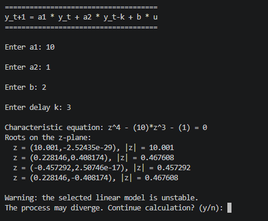
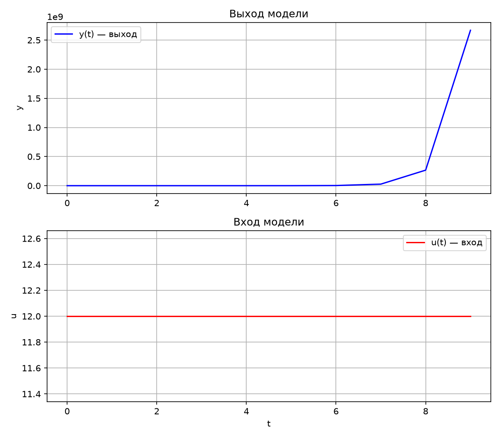
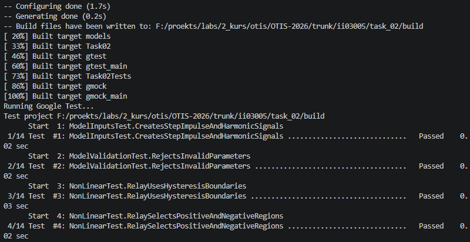
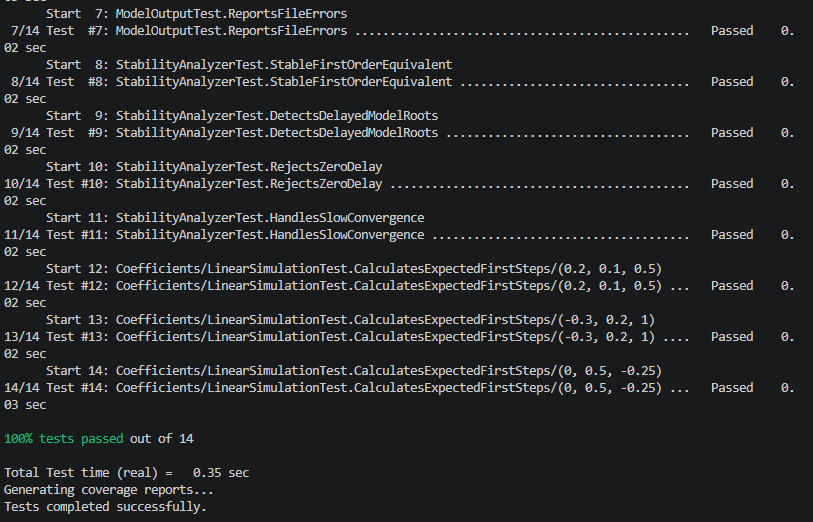
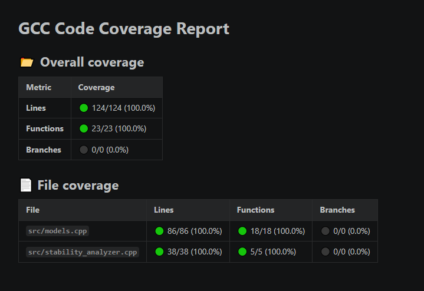

<p align="center">Министерство образования Республики Беларусь</p>
<p align="center">Учреждение образования</p>
<p align="center">«Брестский Государственный технический университет»</p>
<p align="center">Кафедра ИИТ</p>

<br><br><br><br><br>

<p align="center"><b>Лабораторная работа №2</b></p>
<p align="center">по дисциплине «Общая теория интеллектуальных систем»</p>
<p align="center"><b>Тема: «Модульное тестирование и анализ устойчивости»</b></p>

<br><br><br>

<p align="right">Выполнил:</p>
<p align="right">студент 2 курса</p>
<p align="right">группы ИИ-30</p>
<p align="right">Ефименко К. А.</p>

<p align="right">Проверил:</p>
<p align="right">Дворанинович Д. А.</p>

<br><br><br><br><br>

<p align="center">Брест 2026</p>

---

# 1. Цель работы

Добавить к программе первой лабораторной работы анализ устойчивости
линейной модели, проверить основные сценарии с помощью Google Test, и покрытие кода тестами.

# 2. Постановка задачи

В работе используются модели варианта 5:

- линейная модель с задержкой состояния;
- нелинейная модель с релейным элементом и гистерезисом;
- дифференциальная модель с ограничением скорости изменения.

Требовалось:

- найти корни характеристического уравнения линейной модели;
- определить устойчивость по корням на z-плоскости;
- добавить автоматические тесты;
- получить отчёт о покрытии исходного кода.

# 3. Изменения в программе

Вычислительная логика собрана в библиотеку `models`. Файл `main.cpp`
отвечает за меню, ввод параметров и запуск расчёта.

| Файл | Назначение |
|---|---|
| `src/models.h` | объявления базового класса и классов моделей |
| `src/models.cpp` | реализация моделей и работы с входными сигналами |
| `src/stability_analyzer.h` | интерфейс анализатора устойчивости |
| `src/stability_analyzer.cpp` | поиск корней и проверка устойчивости |
| `src/main.cpp` | пользовательский интерфейс программы |
| `test/models_test.cpp` | модульные тесты |

Для линейной модели используется уравнение:

```text
z^(k+1) - a1*z^k - a2 = 0
```

Корни находятся численным методом Дюрандта—Кернера. Система считается
устойчивой, если для каждого корня выполняется условие:

```text
|z_i| < 1
```







# 4. Модульное тестирование

Для тестирования используется Google Test, подключаемый через CMake.
Тесты запускаются программой:

```bat
run_tests.bat
```

Проверяются следующие сценарии:

- формирование ступенчатого, импульсного и гармонического сигналов;
- расчёт трёх математических моделей;
- проверка некорректных параметров;
- работа релейного элемента на границах гистерезиса;
- сохранение результатов в CSV;
- обработка ошибки открытия файла;
- устойчивые и неустойчивые наборы коэффициентов;
- обработка нулевой задержки.

Всего зарегистрировано 14 тестов, все тесты успешно пройдены.





# 5. Покрытие кода

Покрытие формируется утилитой `gcovr` и сохраняется в Markdown-файл
`build/coverage.md`. В отчёт включаются только файлы реализации `.cpp`;
заголовочные файлы и сторонние библиотеки не учитываются.

Полученные результаты:

| Показатель | Значение |
|---|---:|
| Тесты | 14/14 |
| Покрытие строк | 100% |
| Покрытие функций | 100% |





# 6. Вывод

В результате работы был добавлен анализ устойчивости линейной модели 
и реализовано предупреждение о неустойчивом режиме. 
С помощью Google Test проверены основные вычисления, граничные
условия и обработка ошибок. Все тесты пройдены, покрытие строк и функций
реализации составило 100%.
