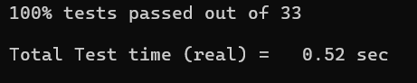
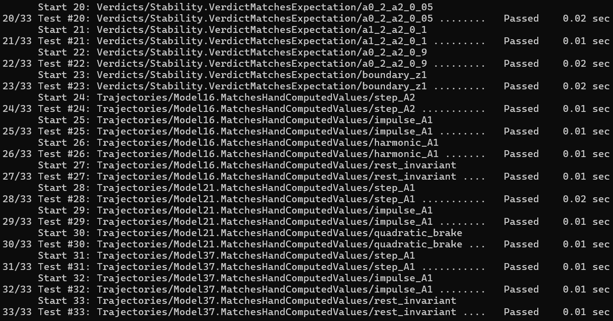
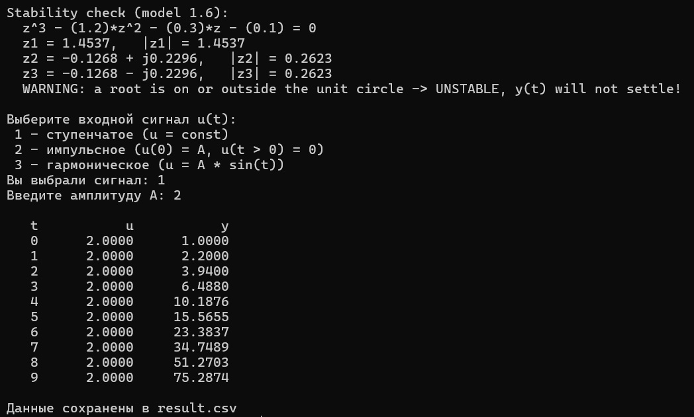
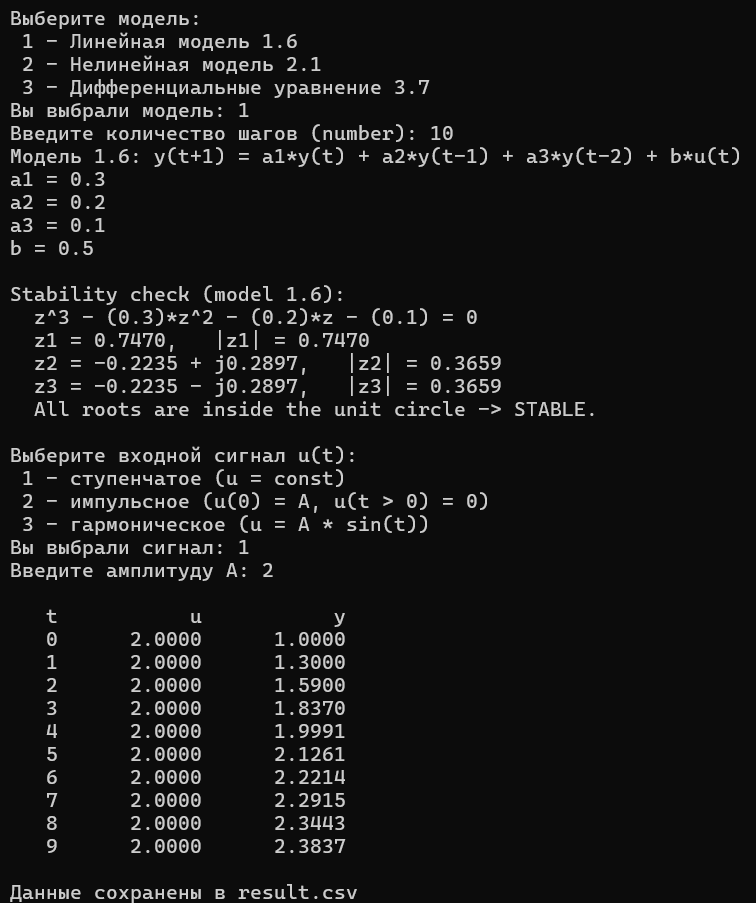
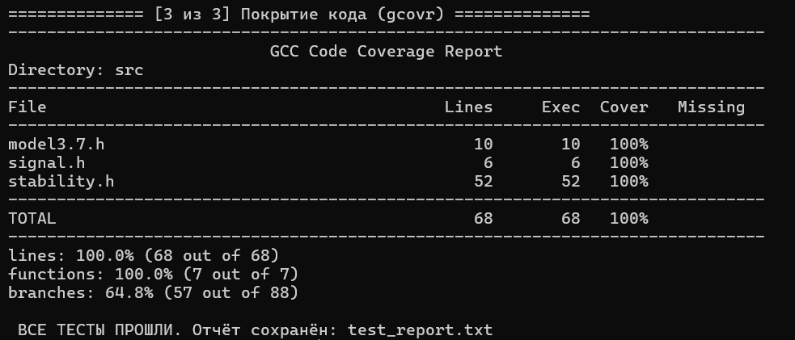

<p align="center"> Министерство образования Республики Беларусь</p>
<p align="center">Учреждение образования</p>
<p align="center">“Брестский Государственный технический университет”</p>
<p align="center">Кафедра ИИТ</p>
<br><br><br><br><br><br><br>
<p align="center">Лабораторная работа №2</p>
<p align="center">По дисциплине “Общая теория интеллектуальных систем”</p>
<p align="center">Тема: “Модульное тестирование и анализ устойчивости”</p>
<br><br><br><br><br>
<p align="right">Выполнил:</p>
<p align="right">Студент 2 курса</p>
<p align="right">Группы ИИ-30</p>
<p align="right">Киселевич А. В.</p>
<p align="right">Проверил:</p>
<p align="right">Дворанинович Д. А.</p>
<br><br><br><br><br>
<p align="center">Брест 2026</p>

## 1. Цель работы

Научиться разбивать программу на отдельные проверяемые единицы и прогонять
их через фреймворк **Google Test**: составлять проверки по эталонным
значениям, которые пересчитаны вручную, параметризовать повторяющиеся
сценарии таблицами данных, отличать устойчивые коэффициенты от расходящихся
по корням характеристического уравнения и измерять долю исполняемого кода,
реально выполненную во время тестирования (тестовое покрытие). По ходу
практикуются механизмы ООП — наследование от базового класса модели,
виртуальные методы и доступ к объектам через указатели — на коде, уже
написанном в лабораторной работе №1.

## 2. Предмет работы и требования к нему

Программа, которую проверяют, — итог ЛР1 (папка `trunk/ii03007/task_01/`):
меню с выбором модели, три модели — линейная 1.6 (помнит два последних
выхода), нелинейная 2.1 (квадрат прошлого выхода плюс синус прошлого
входа) и непрерывная 3.7, интегрируемая явным Эйлером, — три типа
воздействия (ступень, импульс, гармоника) и выгрузка траектории в
`result.csv`.

По методичке от этой работы требуется:

1. модульные тесты на Google Test; запуск — bat-файл, внутри CMake + ctest;
2. вычисления моделей сверять со значениями, полученными пересчётом;
3. модуль устойчивости обязан давать верный ответ: сходящийся набор —
   `true`, расходящийся — `false`, а корень, лежащий ровно на окружности
   $|z| = 1$, — система тоже считается неустойчивой;
4. нелинейность модели 2.1 (член $-b\,y^2$) проверить отдельным кейсом;
5. там, где одна и та же проверка прогоняется по нескольким наборам
   параметров, использовать таблицы `TEST_P` (п.8 методички) — код не
   дублируется;
6. три режима воздействия подавать подменой входа фиксированными
   последовательностями (п.9 методички); Google Mock не подключается;
7. отчёт обязан содержать процент покрытия кода.

## 3. Что изменено по сравнению с ЛР1

Логика программы вынесена из `main.cpp` в небольшие заголовки — так каждый
элемент можно скомпилировать и проверить сам по себе, без меню и консоли:

| Что сделано                                  | Файл              | Зачем                                                                                             |
|----------------------------------------------|-------------------|---------------------------------------------------------------------------------------------------|
| Добавлен модуль устойчивости                 | `src/stability.h` | решает характеристическое кубическое уравнение $z^3 - a_1 z^2 - a_2 z - a_3 = 0$ (формулы Кардано или тригонометрический метод, всё в `double`, без комплексных чисел), считает модули корней, выдаёт вердикт «все корни строго внутри единичного круга» и печатает отчёт **в переданный поток** `std::ostream&`: в программе поток — экран, в тесте — строка, которую можно проверить                                                           |
| Вынесен генератор сигнала                    | `src/signal.h`    | функция `checkSignal` (ступень, импульс, гармоника) жила в `main.cpp`; теперь она в заголовке — одна и та же реализация служит и программе, и тестам                                                                                                                   |
| Добавлено начальное значение в модель Эйлера | `src/model3.7.h`  | копия 3.7 из ЛР1, конструктор дополнительно принимает $y_0$ (по умолчанию 0 — прежние вызовы не меняются); без этого тест «Эйлер против точного решения» не мог бы стартовать с $y(0) = 1$                                                                             |
| Имена копий тестов                           | `test/*.cpp`      | копии `TEST_P` в отчёте ctest подписаны по смыслу (step_A2, boundary_z1), а не адресом из памяти  |

## 4. Структура проекта

Рабочая папка в репозитории: `trunk/ii03007/task_02/`.

| Файл                      | Что внутри                                                                                                                        |
|---------------------------|-----------------------------------------------------------------------------------------------------------------------------------|
| `src/`                    | заголовки, которые исполняют тесты: `model3.7.h` (копия с $y_0$), `signal.h`, `stability.h` |
| `test/test_models.cpp`    | 15 тестов: первые шаги трёх моделей против ручного счёта, «квадратичный тормоз», покой, `clearState()`, полиморфизм, Эйлер против аналитики                                                                                                                                                       |
| `test/test_stability.cpp` | 14 тестов: вердикты по 7 наборам, значения корней, граница $|z| = 1$, нулевой набор, текст отчёта                                 |
| `test/test_signal.cpp`    | 4 теста: каждый режим `checkSignal` + неизвестный тип                                                                             |
| `run_tests.bat`           | одной командой: CMake → сборка тестов → ctest (отчёт в `test_report.txt`) → сводка gcovr                                            |
| `test/CMakeLists.txt`     | загрузка Google Test 1.15.2, правило сборки тестового exe, регистрация тестов в ctest                                             |
 
Тестовый исполняемый файл при сборке заносит в ctest каждый из 33 тестов
отдельной строкой — в отчёте читается результат каждого сценария. Интернет
нужен один раз, на первой сборке (CMake скачивает архив Google Test);
впоследствии сборка идёт полностью локально.


## 5. Ручные пересчёты

Все «ожидаемые» значения в таблицах тестов записаны после ручного счёта по
формулам моделей; ниже — основные развёртки.


### 5.1. Правильность значений 

**Модель 1.6**, $y_{t+1} = a_1 y_t + a_2 y_{t-1} + a_3 y_{t-2} + b u_t$,
набор $\{0.3;\ 0.2;\ 0.1;\ 0.5\}$, ступень амплитудой 2:

$$y_0 = 0.5 \cdot 2 = 1.0 \qquad
y_1 = 0.3 \cdot 1.0 + 0.5 \cdot 2 = 1.3 \qquad
y_2 = 0.3 \cdot 1.3 + 0.2 \cdot 1.0 + 0.1 \cdot 0 + 0.5 \cdot 2 = 1.59$$

Тот же приём — для импульса (ненулевой только первый такт:
$y_0 = 0.5,\ y_1 = 0.3 \cdot 0.5 = 0.15,\ y_2 = 0.3 \cdot 0.15 + 0.2 \cdot 0.5 = 0.145$)
и для гармоники (вход — $\sin t$ в радианах, первые три входа
$0;\ 0.841470985;\ 0.909297427$, выходы $0;\ 0.420735;\ 0.580869$).

**Модель 2.1**, $y_{t+1} = a y_t - b\,y_{t-1}^2 + c u_t + d \sin u_{t-1}$,
набор $\{0.4;\ 0.05;\ 1;\ 0.5\}$, ступень $A = 1$:

$$y_0 = 1.0 \qquad
y_1 = 0.4 \cdot 1.0 + 1.0 + 0.5 \sin 1 = 1.820735 \qquad
y_2 = 0.4 \cdot 1.820735 - 0.05 \cdot 1.0^2 + 1.0 + 0.5 \sin 1 = 2.099030$$

**Модель 3.7**, Эйлер $y_{t+1} = y_t + h\,(-e^a y_t + b u_t)$,
$a = 0.2$, $b = 1$, $h = 0.5$, $e^{0.2} = 1.221403$, ступень $u = 1$:

$$y_0 = 0.5 \qquad
y_1 = 0.5 + 0.5 \cdot (1 - 1.221403 \cdot 0.5) = 0.694649 \qquad
y_2 = 0.770426$$

И у каждой модели прогнан «покойный» случай: нулевой вход и нулевое
состояние дают нулевые выходы на всех тактах — без возбуждения система
не сдвигается.

### 5.2. Как проверяется устойчивость модели 1.6

Характеристическое уравнение 1.6 — кубическое, $z^3 - a_1 z^2 - a_2 z - a_3 = 0$:
степень совпадает с числом «ячеек памяти» модели. Система считается
устойчивой, только если все три корня оказываются строго внутри единичного
круга. Код находит корни без комплексных чисел: по Кардано — один
вещественный и сопряжённая пара, тригонометрическим методом — три
вещественных.

Таблица из 7 наборов для параметризованного теста:

| $a_1$ | $a_2$ | $a_3$ | Корни                                                     | Вердикт  |
|:-----:|:-----:|:-----:|-----------------------------------------------------------|:--------:|
| 0.3   | 0.2   | 0.1   | $0.746971$; $-0.223485 \pm j0.289704$, $\|z\| = 0.365888$ | STABLE   |
| 0.5   | 0.3   | 0.05  | $0.896729$; пара строго в круге, $\|z\| = 0.236132$       | STABLE   |
| 0.5   | −0.3  | 0.05  | $0.209050$; комплексная пара, $\|z\| = 0.489057$          | STABLE   |
| 0.2   | 0.3   | 0.05  | $0.716283$; комплексная пара, $\|z\| = 0.264206$          | STABLE   |
| 1.2   | 0.3   | 0.1   | $z_1 = 1.453692$ — вне круга                              | UNSTABLE |
| 0.2   | 0.9   | 0.1   | три вещественных: $1.100436;\ -0.115818;\ -0.784618$      | UNSTABLE |
| 0.0   | 1.0   | 0.0   | $z_1 = 1$ — **ровно на окружности**                       | UNSTABLE |

Последняя строка — предельная: корень лёг точно на границу. Поэтому
сравнение в коде строгое: модуль, равный 1, устойчивость не даёт.
Отдельный набор $\{0.5;\ 0.5;\ 0\}$ (корни $1;\ 0;\ -0.5$) проверяется
отдельно: из круга не торчит ничего, а вердикт остаётся UNSTABLE. Ещё
отдельно зафиксированы числа: корни первого набора с точностью $1e{-5}$,
равенство модулей у сопряжённой пары, нулевой набор (тройной корень в
нуле — устойчиво) и текст отчёта — слово `WARNING` обязано быть в
расходящемся отчёте и отсутствовать в устойчивом.

> Ручная сверка первой строки: подстановкой $z = t - a_1/3$ уравнение
> приводится к виду $t^3 + At + B = 0$ с $A = -0.23$, $B = -0.122$;
> дискриминант $D = (B/2)^2 + (A/3)^3 = 0.003270 > 0$, значит один
> вещественный корень $t_1 = 0.646912$, то есть $z_1 = 0.746971$, и пара
> $-0.223485 \pm j0.289704$. Программа печатает ровно эти числа перед
> симуляцией.

### 5.3. Квадратичный член: что показывает тест

Чтобы убедиться, что член $-b\,y_{t-1}^2$ действительно работает в коде,
ему дают режим, где он доминирует: $a = 0$, $b = 1$, $c = 2$, $d = 0$,
вход $\{1,0,0,0,0\}$. Выход получается $y = \{2;\ 0;\ -4;\ 0;\ -16\}$ —
рост модуля ($-4 \to -16$) — результат возведения прошлого выхода в квадрат;
никакая линейная система такой последовательности не дала бы.
С «рабочим» набором $\{0.4;\ 0.05;\ 1;\ 0.5\}$ роль квадратичного члена
мала, и траектории (ступень $1.0 \to 1.820735 \to 2.099030$, импульс
$1.0 \to 0.820735 \to 0.278294$) показывают, что член $d\sin u_{t-1}$
действительно смотрит в предыдущее значение входа.

### 5.4. Непреложные свойства и схема Эйлера против точного решения (3.7)

1. При $a = 0$, $b = 0$ дифференциальное уравнение — $\dot y = -y$;
   с $y(0) = 1$ (именно ради этого в модель добавлен параметр $y_0$)
   точное решение $e^{-t}$. Сто шагов Эйлера при $h = 0.01$ дают
   $(1 - h)^{100} = 0.366032$ против точного $e^{-1} = 0.367879$:
   разрыв $0.0019$ укладывается в допуск $0.01$ — это ожидаемая ошибка
   метода первого порядка, а совпадение с замкнутой формулой
   $(1-h)^{100}$ — точное до $1e{-12}$.
2. `clearState()` возвращает 3.7 в значение $y_0$, а не в ноль: тест
   сначала «разгоняет» состояние, сбрасывает его, затем сравнивает
   следующие выходы с выходами свежего объекта — совпадает.
3. Модель, созданная и уничтоженная через указатель `BaseModel*` (так же,
   как `unique_ptr` в main), считает те же значения — виртуальный
   механизм работает.


### 5.5. Поведение функции checkSignal (test_signal.cpp)

Каждый из четырёх тестов фиксирует одно поведение функции:

- **ступень** — на любом такте (проверено t = 0…4) возвращается амплитуда,
  сигнал не зависит от времени;
- **импульс** — амплитуда выдаётся только первым вызовом, все последующие
  возвращают ноль;
- **гармоника** — значение совпадает с $A \sin t$ в каждом целом t
  (синус берётся в радианах; при $t = 1$ это 0.841470985);
- **неизвестный номер типа** — программа не падает, просто возвращает ноль.

### 5.6. Режимы входа без Google Mock (п.9)

Мок-объект нужен, когда метод зависит от чего-то внешнего — файла, сети,
базы данных — и эту зависимость в тесте хочется подменить. У наших моделей
внешних зависимостей нет: `stepForward(u)` принимает число и возвращает
число, а этого достаточно, чтобы проверить её полностью. Поэтому «подмена
входа» сделана самым простым способом: вместо живого сигнала модель
получает столбик чисел, заранее записанный в таблицу (массив `u[]`), а
столбик этот как раз и есть ступень, импульс или гармоника. Та же идея
применена к отчёту об устойчивости: он печатается в поток, переданный
аргументом, — тест передаёт не экран, а строковый буфер, текст которого
затем проверяется. Иными словами, проверяется результат вычислений, а не
то, какие методы были вызваны; на этом месте mock-фреймворк оказался бы
лишним.

## 6. Что даёт прогон тестов

Запускается bat-файл `run_tests.bat` из папки `task_02`:

```
100% tests passed out of 33
Total Test time (real) = 0.52 sec
```

Пройдено 33 из 33, ни одного падения. Отчёт при этом не одна строка, а
список — каждая копия параметризованного теста подписана своим именем:

```
24/33 Test #24: Trajectories/Model16.MatchesHandComputedValues/step_A2 ... Passed
33/33 Test #33: Trajectories/Model37.MatchesHandComputedValues/rest_invariant ... Passed
```


*Рис. 1. Успешный прогон тестов*

 

*Рис. 2. Параметризованные тесты в отчёте ctest*

Модифицированная программа ведёт себя так, как задумывалось:
расходящийся набор ($a_1 = 1.2$, $a_2 = 0.3$, $a_3 = 0.1$) получает
предупреждение **до** старта симуляции, а дальнейший расчёт действительно
разбежался ($y$ ушёл от 1.0 до 75.29 за 10 шагов):



*Рис. 3. Предупреждение о неустойчивости до расчёта*

Сходящийся набор из ЛР1 ($0.3;\ 0.2;\ 0.1;\ 0.5$) получает STABLE, и выход
прижимается к рассчитанному установившемуся значению
$bA/(1 - a_1 - a_2 - a_3) = 2.5$:



*Рис. 4. Устойчивый набор: выход стремится к 2.5*

## 7. Покрытие кода

Замер — gcov/gcovr (MinGW GCC); флаги `-O0 --coverage` достаются только
тестовому исполняемому файлу. Интерактивный `main.cpp` из замера
исключён флагом `--exclude`: это меню и ввод-вывод, а не та логика,
которую тестировали.

| Модуль        | Строки            | Функции         | Комментарий                                          |
|---------------|:-----------------:|:---------------:|------------------------------------------------------|
| `model3.7.h`  | 100 % (10/10)     | 100 %           | Эйлер + ветка конструктора с $y_0$ + `clearState`    |
| `signal.h`    | 100 % (6/6)       | 100 %           | все три режима + ветка по умолчанию                  |
| `stability.h` | 100 % (52/52)     | 100 %           | обе ветки Кардано/тригонометрии, оба исхода вердикта |
| **Итого**     | **100 % (68/68)** | **100 % (7/7)** | **Success**                                          |

Примечания:
- модели 1.6 и 2.1 в сводке не значатся: их файлы принадлежат проекту ЛР1
  (`task_01/src`) и не копируются в task_02; при замере с корнем `-r ../`
  эти две модели тоже показывают 14/14 строк — те же тесты их исполняют;
- метрика ветвлений в отчёт не заносится — задание требует покрытие
  строк и функций.

Команда замера (после `run_tests.bat`, из папки `task_02`):

```
gcovr -r src build --print-summary --exclude ".*main\.cpp"
```



*Рис. 5. Сводка gcovr по запуску*

## 8. Где выполнено каждое требование

| Требование задания                                      | Где в проекте                                              |
|---------------------------------------------------------|------------------------------------------------------------|
| Google Test, запуск через CMake/ctest                   | `test/` и `run_tests.bat`                                  |
| Значения по ручному пересчёту                           | раздел 5.1, таблицы `kCases16/21/37`                       |
| Устойчивость: сходится / расходится / граница $|z| = 1$ | раздел 5.2, 7 наборов + 2 граничных теста                  |
| Границы нелинейности                                    | раздел 5.3, «квадратичный тормоз»                          |
| `TEST_P` без дублирования (п.8)                         | 3 таблицы (10 копий) + таблица вердиктов (7 копий)         |
| Режимы входа без Mock (п.9)                             | раздел 5.6                                                 |
| Вывод предупреждения о расходимости                     | `printStabilityCheck` в `src/stability.h`, тесты `Report*` |
| Покрытие в отчёте                                       | раздел 7: строки 68/68, функции 7/7                        |

## 9. Выводы

1. Программа ЛР1 обзавелась проверкой устойчивости: до симуляции 1.6
   решается характеристическое кубическое уравнение, и расходящийся набор
   коэффициентов пользователь видит в виде строки `WARNING` раньше, чем
   начались вычисления.
2. Тридцать три модульных теста на Google Test легли поверх не тронутой
   логики моделей; все они проходят, а «ожидаемые» значения — это ручной
   пересчёт первых шагов моделей.
3. Таблицы `TEST_P` убрали дублирование: одна и та же проверка прогоняется
   по всем наборам параметров, а в отчёте ctest копии различаются по
   именам, а не по адресам.
4. Предельные случаи — корень точно на окружности, тройной нулевой корень,
   «квадратичный тормоз», Эйлер против точного решения — показали, что
   критерий устойчивости применяется строго ($< 1.0$), а схема решает
   именно своё уравнение.
5. Модули `task_02/src` покрыты полностью: 68/68 строк и 7/7 функций;
   модели ЛР1, подключённые путём из `task_01`, исполняются теми же
   тестами (14/14 строк каждая).
